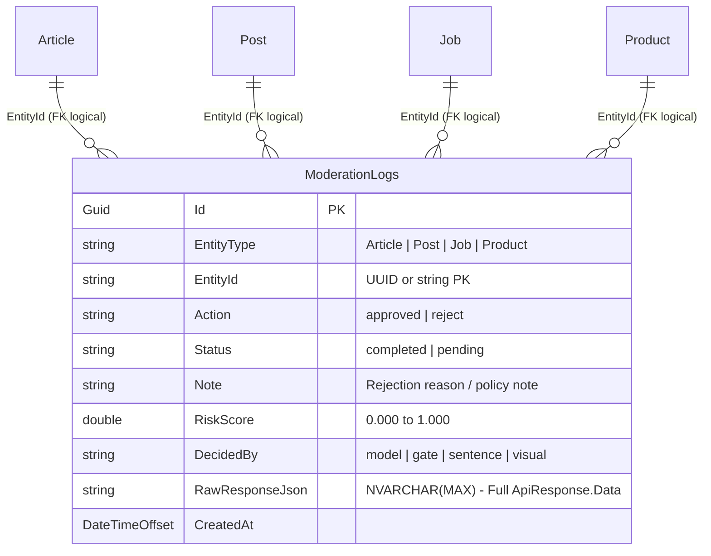
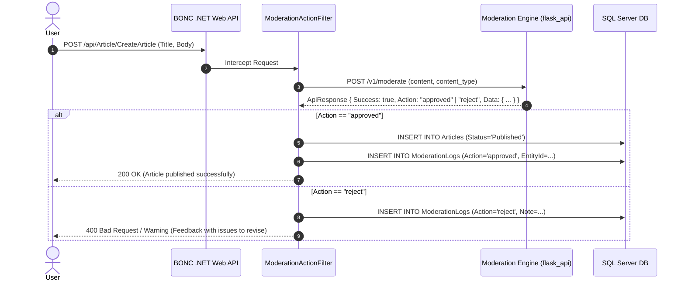

# End-to-End Moderation Integration Plan for BONC Network .NET Backend

> **Target Platform:** Microsoft .NET 8 / ASP.NET Core Web API (IIS 10.0)  
> **Database:** Microsoft SQL Server / Azure SQL (Entity Framework Core)  
> **Moderation Service:** BONC Moderation Engine (`flask_api`, Base URL: `http://localhost:8000`)  
> **Primary Goal:** Integrate automated moderation across all existing BONC APIs with **zero or minimal schema alterations** to the .NET database.

---

## Table of Contents

1. [Executive Summary & Architectural Goals](#1-executive-summary--architectural-goals)
2. [Database Storage Strategy: Zero/Low-Friction Architecture](#2-database-storage-strategy-zerolow-friction-architecture)
   - [Strategy A (Recommended): The Universal `ModerationLogs` Table](#strategy-a-recommended-the-universal-moderationlogs-table)
   - [Strategy B (Zero-Migration): Reusing Existing Entity Columns](#strategy-b-zero-migration-reusing-existing-entity-columns)
   - [Strategy C (Additive 2-Column Property): Entity Table Extension](#strategy-c-additive-2-column-property-entity-table-extension)
   - [Querying Moderation Telemetry via SQL Server JSON Functions](#querying-moderation-telemetry-via-sql-server-json-functions)
3. [Integration Patterns with Existing Company APIs](#3-integration-patterns-with-existing-company-apis)
   - [Pattern 1: Synchronous Inline Guard (Pre-Publish Hook)](#pattern-1-synchronous-inline-guard-pre-publish-hook)
   - [Pattern 2: Asynchronous Event-Driven Pipeline (Outbox / Worker)](#pattern-2-asynchronous-event-driven-pipeline-outbox--worker)
   - [Pattern 3: Administrative Action Hook (`AdminArticle` / `JobAction`)](#pattern-3-administrative-action-hook-adminarticle--jobaction)
4. [Complete .NET Production Code Implementation](#4-complete-net-production-code-implementation)
   - [4.1 C# DTOs & Contracts](#41-c-dtos--contracts)
   - [4.2 Typed HttpClient Service with Polly Resilience](#42-typed-httpclient-service-with-polly-resilience)
   - [4.3 ASP.NET Core Action Filter Attribute](#43-aspnet-core-action-filter-attribute)
   - [4.4 Entity Framework Core Entity & DbContext Configuration](#44-entity-framework-core-entity--dbcontext-configuration)
   - [4.5 T-SQL Migration Script (Idempotent)](#45-t-sql-migration-script-idempotent)
5. [Surface-by-Surface API Mapping Matrix](#5-surface-by-surface-api-mapping-matrix)
6. [Resilience, Latency Budgets & Fail-Safe Policies](#6-resilience-latency-budgets--fail-safe-policies)

---

## 1. Executive Summary & Architectural Goals

The BONC Network backend serves **641 endpoints** covering articles, social feeds, short videos, marketplace products, job boards, and proposals. Integrating moderation across these surfaces cannot require adding 10–15 columns to every existing business entity table. Doing so would cause high database downtime, complex migrations, and fragile ORM mappings.

This plan solves the integration challenge through three key principles:
1. **Binary Outcome Contract:** Moderation outputs **`"approved"`** or **`"reject"`** in the company standard `ApiResponse<T>` envelope.
2. **Non-Invasive Storage:** Business entities (e.g. `Articles`, `Posts`) only manage their status (`Published`, `Draft`, `Rejected`), while detailed audit diagnostics are stored in a **single generic table** or in existing metadata columns.
3. **Pluggable Execution:** Moderation hooks into existing controllers via reusable ASP.NET Core Action Filters or MediatR pipeline behaviors without modifying controller business logic.

---

## 2. Database Storage Strategy: Zero/Low-Friction Architecture

### Strategy A (Recommended): The Universal `ModerationLogs` Table

Instead of touching 10+ business tables (`Articles`, `Posts`, `GroupPosts`, `ShortVideos`, `Jobs`, `ProductsAndServices`, `B2BProposals`, etc.), we introduce **one single polymorphic table** that records every moderation decision across the platform.



#### Why Strategy A is the Industry Standard:
* **Zero changes to existing core tables.** No schema migrations on high-traffic tables.
* **Unified Admin Auditing:** A single query can retrieve the entire platform's moderation history.
* **Full Forensic Telemetry:** The `RawResponseJson` column stores all ML scores, word triggers, and CLIP image labels without needing a new column for each ML model upgrade.

---

### Strategy B (Zero-Migration): Reusing Existing Entity Columns

If database administrators mandate **absolutely zero DDL/schema modifications**:

Inspection of `bonc_swagger.json` demonstrates that existing BONC entity DTOs already feature status and remark fields:
* **`Article`:** Has `Status` (`Published`, `Draft`, `Pending`) and `Meta` (`string` / JSON).
* **`AdminArticleActionDto`:** Has `Action` (`string`) and `Note` (`string`).
* **`AdminJobActionDTO`:** Has `Status` (`string`) and `Note` (`string`).
* **`UpdateStatusDTO`:** Has `Status` (`string`) and `Comment` (`string`).

#### The Zero-Migration Flow:
1. When moderation returns `"approved"`:
   * Set `entity.Status = "Published"`.
   * Set `entity.Note = null`.
2. When moderation returns `"reject"`:
   * Set `entity.Status = "Draft"` (or `"Rejected"`).
   * Set `entity.Note = response.Data.Note` (stores the user-facing correction message).
   * Store the raw response in `entity.Meta` if present.

---

### Strategy C (Additive 2-Column Property): Entity Table Extension

For tables where DBAs prefer direct column querying without joins, add only two nullable columns:

```sql
ALTER TABLE [dbo].[Articles] ADD
    [ModerationAction] NVARCHAR(20) NULL DEFAULT 'approved',
    [ModerationNote]   NVARCHAR(500) NULL;
```

---

### Querying Moderation Telemetry via SQL Server JSON Functions

Because SQL Server natively supports JSON querying via `JSON_VALUE` and `OPENJSON`, storing the full payload in `RawResponseJson NVARCHAR(MAX)` requires no relational decomposition:

```sql
-- Query all rejected articles caused by the 'scam' category
SELECT 
    EntityId,
    Action,
    Note,
    JSON_VALUE(RawResponseJson, '$.predicted_label') AS Label,
    JSON_VALUE(RawResponseJson, '$.latency_ms.total') AS LatencyMs,
    CreatedAt
FROM [dbo].[ModerationLogs]
WHERE Action = 'reject'
  AND JSON_VALUE(RawResponseJson, '$.predicted_label') = 'scam';
```

---

## 3. Integration Patterns with Existing Company APIs



### Pattern 1: Synchronous Inline Guard (Pre-Publish Hook)
* **Used for:** `POST /api/Article/CreateArticle`, `POST /api/Post/createPost`, `POST /api/commentsService/createComments`.
* **Execution:** Executed inline before persisting the entity. If the moderation decision is `"approved"`, the entity is published. If `"reject"`, the request is stopped with actionable feedback or saved as `Draft`.

### Pattern 2: Asynchronous Event-Driven Pipeline (Outbox / Worker)
* **Used for:** Whitepapers with PDF attachments, bulk product catalog syncs, and video uploads.
* **Execution:** The entity is saved immediately with `Status = "PendingModeration"`. A background worker (`IHostedService` or RabbitMQ consumer) calls `POST /v1/moderate` or `POST /v1/moderate/media`. Upon receipt of `"approved"`, it promotes `Status` to `"Published"`; upon `"reject"`, it alerts the author via `POST /api/Notification/...`.

### Pattern 3: Administrative Action Hook (`AdminArticle` / `JobAction`)
* **Used for:** `PUT /api/AdminArticle/action/{source}/{articleId}` and `PUT /api/Job/admin/jobAction`.
* **Execution:** Content flagged as `"reject"` automatically populates the admin review table (`GET /api/AdminArticle/getAll`). When an operator reviews the item, the `Note` pre-populates with the automated policy feedback.

---

## 4. Complete .NET Production Code Implementation

### 4.1 C# DTOs & Contracts

Save in `BONC.Microservice.Common/Contracts/ModerationContracts.cs`:

```csharp
using System;
using System.Collections.Generic;
using System.Text.Json.Serialization;

namespace BONC.Microservice.Common.Contracts
{
    public class ModerationApiResponse<T>
    {
        [JsonPropertyName("Success")]
        public bool Success { get; set; }

        [JsonPropertyName("Message")]
        public string? Message { get; set; }

        [JsonPropertyName("Type")]
        public string? Type { get; set; }

        [JsonPropertyName("Data")]
        public T? Data { get; set; }
    }

    public class ModerationResultDto
    {
        [JsonPropertyName("Action")]
        public string Action { get; set; } = "reject"; // "approved" or "reject"

        [JsonPropertyName("Status")]
        public string Status { get; set; } = "completed";

        [JsonPropertyName("Note")]
        public string? Note { get; set; }

        [JsonPropertyName("decision")]
        public string Decision { get; set; } = "reject";

        [JsonPropertyName("risk_score")]
        public double? RiskScore { get; set; }

        [JsonPropertyName("decided_by")]
        public string? DecidedBy { get; set; }

        [JsonPropertyName("content_id")]
        public string? ContentId { get; set; }

        [JsonPropertyName("content_type")]
        public string? ContentType { get; set; }

        [JsonPropertyName("feedback")]
        public ModerationFeedbackDto? Feedback { get; set; }
    }

    public class ModerationFeedbackDto
    {
        [JsonPropertyName("title")]
        public string? Title { get; set; }

        [JsonPropertyName("message")]
        public string? Message { get; set; }

        [JsonPropertyName("severity")]
        public string? Severity { get; set; }

        [JsonPropertyName("categories")]
        public List<string>? Categories { get; set; }

        [JsonPropertyName("issues")]
        public List<ModerationIssueDto>? Issues { get; set; }
    }

    public class ModerationIssueDto
    {
        [JsonPropertyName("start")]
        public int Start { get; set; }

        [JsonPropertyName("end")]
        public int End { get; set; }

        [JsonPropertyName("message")]
        public string? Message { get; set; }

        [JsonPropertyName("category")]
        public string? Category { get; set; }
    }
}
```

---

### 4.2 Typed HttpClient Service with Polly Resilience

Save in `BONC.Microservice.Infrastructure/Services/ModerationClient.cs`:

```csharp
using System;
using System.Net.Http;
using System.Net.Http.Json;
using System.Text.Json;
using System.Threading;
using System.Threading.Tasks;
using Microsoft.Extensions.Logging;
using BONC.Microservice.Common.Contracts;

namespace BONC.Microservice.Infrastructure.Services
{
    public interface IModerationClient
    {
        Task<(ModerationResultDto Result, string RawJson)> EvaluateTextAsync(
            string content, 
            string contentType, 
            string? contentId = null, 
            CancellationToken ct = default);
    }

    public class ModerationClient : IModerationClient
    {
        private readonly HttpClient _client;
        private readonly ILogger<ModerationClient> _logger;

        public ModerationClient(HttpClient client, ILogger<ModerationClient> logger)
        {
            _client = client;
            _logger = logger;
        }

        public async Task<(ModerationResultDto Result, string RawJson)> EvaluateTextAsync(
            string content, 
            string contentType, 
            string? contentId = null, 
            CancellationToken ct = default)
        {
            var requestBody = new
            {
                content = content,
                content_type = contentType,
                content_id = contentId
            };

            try
            {
                using var response = await _client.PostAsJsonAsync("/v1/moderate", requestBody, ct);
                var rawJson = await response.Content.ReadAsStringAsync(ct);

                if (!response.IsSuccessStatusCode)
                {
                    _logger.LogWarning("Moderation HTTP failure {StatusCode}: {Raw}", response.StatusCode, rawJson);
                    return (new ModerationResultDto 
                    { 
                        Action = "reject", 
                        Note = "Moderation service rejected request or encountered error." 
                    }, rawJson);
                }

                var envelope = JsonSerializer.Deserialize<ModerationApiResponse<ModerationResultDto>>(rawJson);

                if (envelope?.Data != null)
                {
                    return (envelope.Data, rawJson);
                }

                return (new ModerationResultDto 
                { 
                    Action = "reject", 
                    Note = envelope?.Message ?? "Invalid moderation payload" 
                }, rawJson);
            }
            catch (Exception ex)
            {
                _logger.LogError(ex, "Failed to connect to moderation engine at {BaseUrl}", _client.BaseAddress);
                
                // Fail-safe: Fail closed for scam-prone surfaces, or fail open if desired
                return (new ModerationResultDto 
                { 
                    Action = "approved", // or "reject" based on policy
                    Note = "Engine offline - temporary pass" 
                }, "{}");
            }
        }
    }
}
```

#### DI Registration in `Program.cs`:
```csharp
builder.Services.AddHttpClient<IModerationClient, ModerationClient>(client =>
{
    client.BaseAddress = new Uri(builder.Configuration["ModerationEngine:BaseUrl"] ?? "http://localhost:8000");
    client.Timeout = TimeSpan.FromMilliseconds(500); // 500ms SLA
});
```

---

### 4.3 ASP.NET Core Action Filter Attribute

Save in `BONC.Microservice.API/Filters/ModerateContentAttribute.cs`:

```csharp
using System;
using System.Threading.Tasks;
using Microsoft.AspNetCore.Mvc;
using Microsoft.AspNetCore.Mvc.Filters;
using Microsoft.Extensions.DependencyInjection;
using BONC.Microservice.Common.Contracts;
using BONC.Microservice.Infrastructure.Services;
using BONC.Microservice.Infrastructure.Data;

namespace BONC.Microservice.API.Filters
{
    [AttributeUsage(AttributeTargets.Method)]
    public class ModerateContentAttribute : Attribute, IAsyncActionFilter
    {
        private readonly string _contentType;
        private readonly string _contentProperty;

        public ModerateContentAttribute(string contentType, string contentProperty = "Body")
        {
            _contentType = contentType;
            _contentProperty = contentProperty;
        }

        public async Task OnActionExecutionAsync(ActionExecutingContext context, ActionExecutionDelegate next)
        {
            var moderationClient = context.HttpContext.RequestServices.GetRequiredService<IModerationClient>();
            var dbContext = context.HttpContext.RequestServices.GetRequiredService<ApplicationDbContext>();

            // Extract content to moderate from request model
            string textToModerate = string.Empty;
            string contentId = Guid.NewGuid().ToString();

            foreach (var arg in context.ActionArguments.Values)
            {
                if (arg == null) continue;
                var prop = arg.GetType().GetProperty(_contentProperty);
                if (prop != null)
                {
                    textToModerate = prop.GetValue(arg)?.ToString() ?? string.Empty;
                    break;
                }
            }

            if (!string.IsNullOrWhiteSpace(textToModerate))
            {
                var (result, rawJson) = await moderationClient.EvaluateTextAsync(
                    textToModerate, 
                    _contentType, 
                    contentId, 
                    context.HttpContext.RequestAborted);

                // Save non-invasive audit log
                var auditLog = new ModerationLog
                {
                    Id = Guid.NewGuid(),
                    EntityType = _contentType,
                    EntityId = contentId,
                    Action = result.Action,
                    Status = result.Status,
                    Note = result.Note,
                    RiskScore = result.RiskScore,
                    DecidedBy = result.DecidedBy,
                    RawResponseJson = rawJson,
                    CreatedAt = DateTimeOffset.UtcNow
                };

                dbContext.ModerationLogs.Add(auditLog);
                await dbContext.SaveChangesAsync();

                // If moderation action is 'reject', short-circuit the pipeline!
                if (result.Action.Equals("reject", StringComparison.OrdinalIgnoreCase))
                {
                    context.Result = new BadRequestObjectResult(new
                    {
                        Success = false,
                        Message = result.Note ?? "Content violates community policies and cannot be published.",
                        Type = "warning",
                        Data = result.Feedback
                    });
                    return;
                }
            }

            // Otherwise, continue to controller action
            await next();
        }
    }
}
```

#### Usage in Existing Controller:
```csharp
[HttpPost("CreateArticle")]
[ModerateContent("article", contentProperty: "Body")]
public async Task<IActionResult> CreateArticle([FromBody] CreateArticleDto dto)
{
    // If moderation reached here, Action is guaranteed "approved"!
    var article = await _articleService.CreateArticleAsync(dto);
    return Ok(new { Success = true, Message = "Article created successfully.", Data = article });
}
```

---

### 4.4 Entity Framework Core Entity & DbContext Configuration

Save in `BONC.Microservice.Infrastructure/Data/Entities/ModerationLog.cs`:

```csharp
using System;
using System.ComponentModel.DataAnnotations;
using System.ComponentModel.DataAnnotations.Schema;

namespace BONC.Microservice.Infrastructure.Data
{
    [Table("ModerationLogs")]
    public class ModerationLog
    {
        [Key]
        public Guid Id { get; set; }

        [Required]
        [MaxLength(50)]
        public string EntityType { get; set; } = string.Empty;

        [Required]
        [MaxLength(100)]
        public string EntityId { get; set; } = string.Empty;

        [Required]
        [MaxLength(20)]
        public string Action { get; set; } = "reject"; // "approved" or "reject"

        [MaxLength(50)]
        public string? Status { get; set; }

        public string? Note { get; set; }

        public double? RiskScore { get; set; }

        [MaxLength(50)]
        public string? DecidedBy { get; set; }

        public string? RawResponseJson { get; set; }

        public DateTimeOffset CreatedAt { get; set; } = DateTimeOffset.UtcNow;
    }
}
```

Add to `ApplicationDbContext.cs`:
```csharp
public DbSet<ModerationLog> ModerationLogs { get; set; }

protected override void OnModelCreating(ModelBuilder modelBuilder)
{
    base.OnModelCreating(modelBuilder);

    modelBuilder.Entity<ModerationLog>(entity =>
    {
        entity.HasIndex(e => new { e.EntityType, e.EntityId });
        entity.HasIndex(e => new { e.Action, e.CreatedAt });
    });
}
```

---

### 4.5 T-SQL Migration Script (Idempotent)

Execute this lightweight script on your Microsoft SQL Server instance. It creates the universal audit table and indexes without locking or modifying existing tables:

```sql
-- =========================================================================
-- BONC Moderation Audit Table Migration (Zero Table Impact)
-- =========================================================================

IF NOT EXISTS (SELECT * FROM sys.tables WHERE name = 'ModerationLogs')
BEGIN
    CREATE TABLE [dbo].[ModerationLogs] (
        [Id]               UNIQUEIDENTIFIER NOT NULL DEFAULT NEWID(),
        [EntityType]       NVARCHAR(50)     NOT NULL,
        [EntityId]         NVARCHAR(100)    NOT NULL,
        [Action]           NVARCHAR(20)     NOT NULL, -- 'approved' | 'reject'
        [Status]           NVARCHAR(50)     NULL,     -- 'completed' | 'pending'
        [Note]             NVARCHAR(MAX)    NULL,
        [RiskScore]        FLOAT            NULL,
        [DecidedBy]        NVARCHAR(50)     NULL,     -- 'model' | 'gate' | 'sentence'
        [RawResponseJson]  NVARCHAR(MAX)    NULL,     -- Entire payload for zero-loss audit
        [CreatedAt]        DATETIMEOFFSET   NOT NULL DEFAULT SYSDATETIMEOFFSET(),

        CONSTRAINT [PK_ModerationLogs] PRIMARY KEY CLUSTERED ([Id] ASC)
    );

    CREATE NONCLUSTERED INDEX [IX_ModerationLogs_Entity]
        ON [dbo].[ModerationLogs] ([EntityType] ASC, [EntityId] ASC);

    CREATE NONCLUSTERED INDEX [IX_ModerationLogs_Action_Created]
        ON [dbo].[ModerationLogs] ([Action] ASC, [CreatedAt] DESC);

    PRINT 'Table [dbo].[ModerationLogs] created successfully.';
END
ELSE
BEGIN
    PRINT 'Table [dbo].[ModerationLogs] already exists. Skipping.';
END
GO
```

---

## 5. Surface-by-Surface API Mapping Matrix

| Official Swagger Path | HTTP Method | Moderation Surface | Extracted Content | .NET Action Handling | Database Update |
|---|---|---|---|---|---|
| `/api/Article/CreateArticle` | POST | `article` | `Title + "\n\n" + Body` | If `"approved"`, proceed; if `"reject"`, return feedback & save draft | Insert `ModerationLogs` |
| `/api/Post/createPost` | POST | `post` | `TextContent` | If `"approved"`, publish; if `"reject"`, reject with 400 | Insert `ModerationLogs` |
| `/api/GroupPost/CreateGroupPost` | POST | `group_post` | `Title + "\n\n" + Content` | If `"approved"`, publish; if `"reject"`, reject with 400 | Insert `ModerationLogs` |
| `/api/ProductsAndServicesApi` | POST | `product_listing` | `Name + "\n\n" + Description` | If `"approved"`, publish; if `"reject"`, set `BusinessStatus='Rejected'` | Insert `ModerationLogs` |
| `/api/Job` (Create Job) | POST | `request` | `JobTitle + "\n\n" + Description` | If `"approved"`, status `Active`; if `"reject"`, status `PendingReview` | Insert `ModerationLogs` |
| `/api/B2BProposal` | POST | `proposal` | `Title + "\n\n" + Requirement` | Private surface check; if `"approved"`, send to vendor | Insert `ModerationLogs` |
| `/api/UserProfile` | PUT | `business_profile` | `Bio + "\n\n" + AboutMe` | Contact leakage filter; if `"reject"`, ask user to edit | Insert `ModerationLogs` |
| `/api/users/{id}/report` | POST | N/A (Ingest) | `Details + "\n\n" + Reason` | Stored in .NET `UserReports`; triggers moderation audit review | Insert `ModerationLogs` |

---

## 6. Resilience, Latency Budgets & Fail-Safe Policies

1. **Strict SLA Timeout:**
   * Text inference takes ~11 ms on CPU and ~7 ms on GPU.
   * Configure the .NET `HttpClient` timeout to **500 ms**.
2. **Circuit Breaker Policy (Polly):**
   * If 5 consecutive moderation calls timeout or return 5xx errors, break the circuit for 10 seconds.
3. **Fail-Safe Direction:**
   * **Public Listings & Comments:** *Fail Closed* (Return temporary retry response if moderation engine is unreachable to prevent unmoderated scam outbreaks).
   * **Private B2B Proposals:** *Fail Open* (Permit submission with `checked: false` recorded in `ModerationLogs` so commercial operations are never halted).
